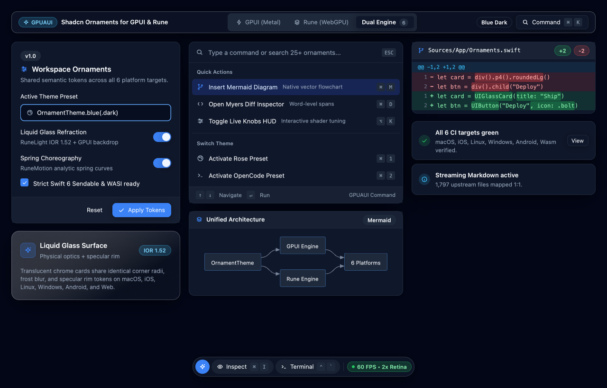
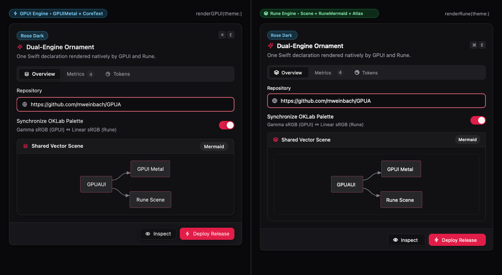
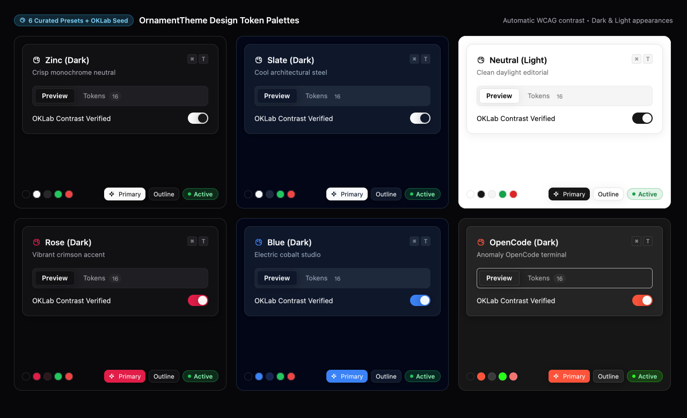
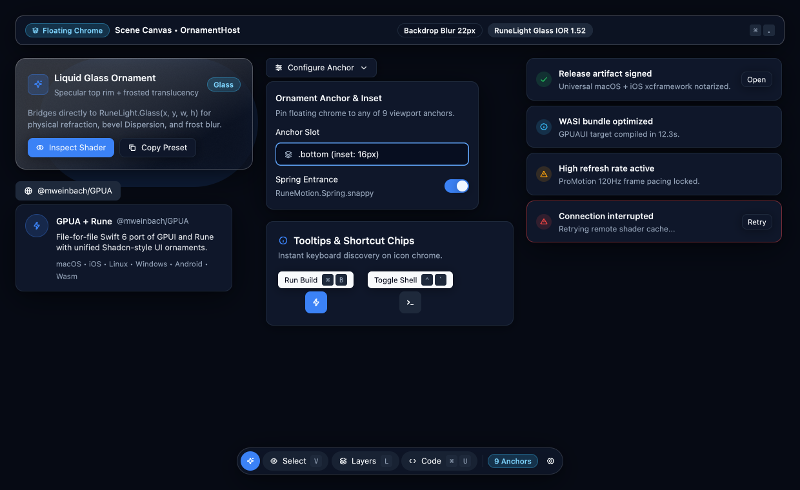
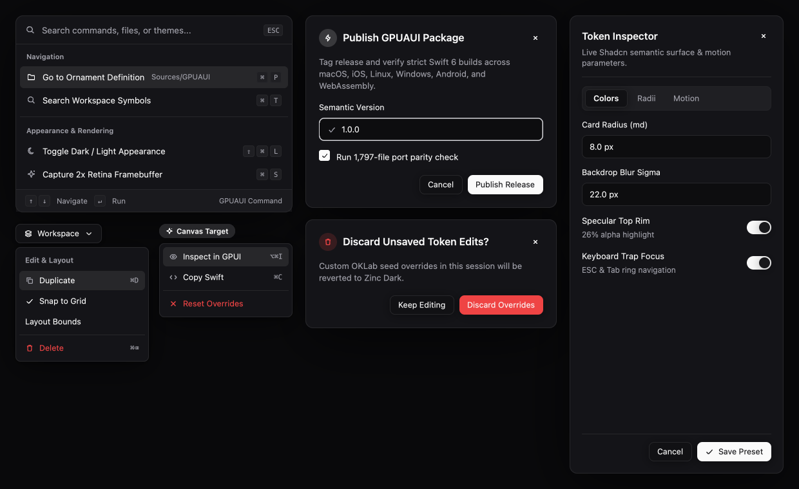
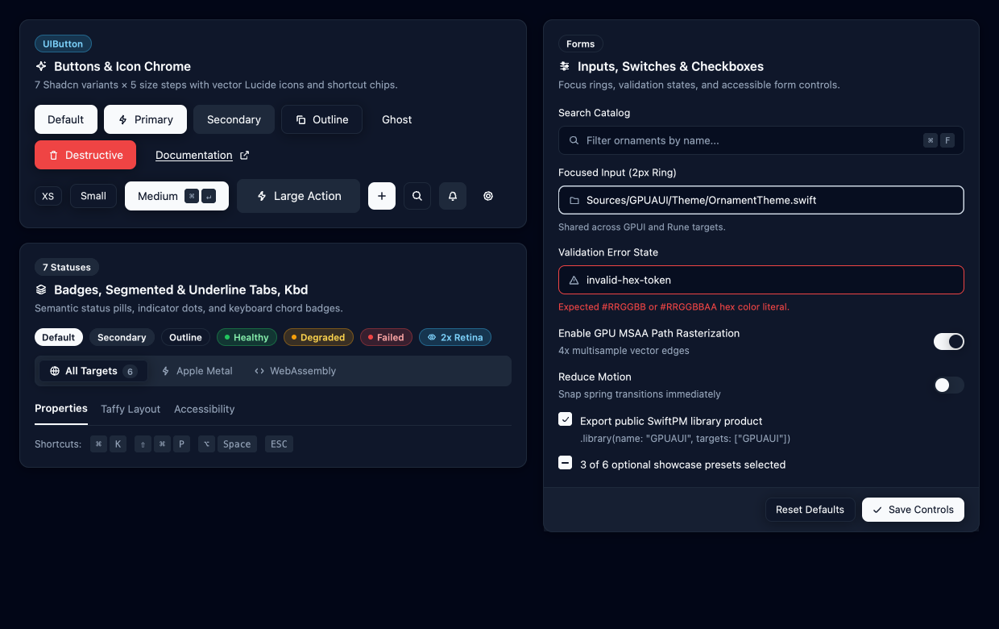
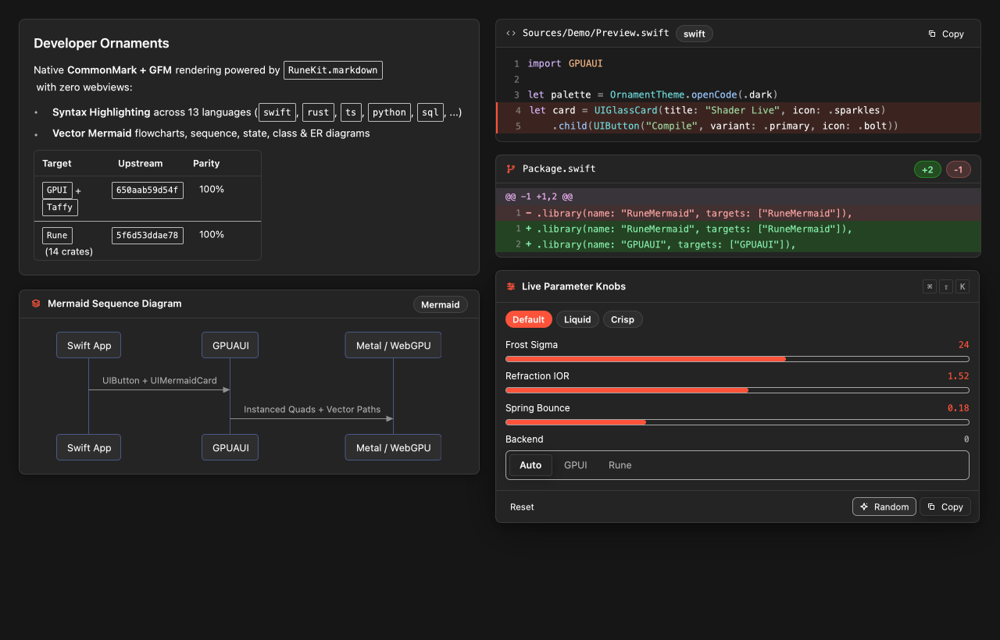

# GPUA

**A file-for-file Swift port of [GPUI](https://github.com/Glass-HQ/gpui) and [Rune](https://github.com/anomalyco/rune).** GPUI is the GPU-accelerated UI framework behind the [Zed](https://zed.dev) editor, and Rune is Anomaly's GPU-rendered UI, analytic spring motion, shader effects, Mermaid diagram, and component toolkit (`rune-kit`). GPUA ships them together in one zero-dependency SwiftPM package (sharing a pure-Swift port of [Taffy](https://github.com/DioxusLabs/taffy)), giving Swift apps a native, GPU-rendered UI SDK across **macOS, iOS / visionOS, Windows, Linux, Android, and the Web (WebAssembly + WebGPU)**.

> [!NOTE]
> All **1,797 mapped upstream files** across `Glass-HQ/gpui` (`650aab59d54f`), `DioxusLabs/taffy` (`v0.9.0`), and all 14 `anomalyco/rune` crates (`5f6d53ddae78`, [ADR-0014](docs/adr/0014-rune-upstream-and-target-layout.md)) are **100% ported** and verified across all six native platform backends in CI — alongside **`GPUAUI`** ([ADR-0015](docs/adr/0015-gpuaui-shadcn-ornaments.md)), a Shadcn-style UI ornament library that renders natively on both `GPUI` and `Rune`. See [docs/GALLERY.md](docs/GALLERY.md), [docs/PORTING_STATUS.md](docs/PORTING_STATUS.md), and [docs/TEST_PARITY.md](docs/TEST_PARITY.md).

<picture>
  <source media="(prefers-color-scheme: light)" srcset="docs/images/gpuaui-hero-light.png">
  
</picture>

## Why

- **GPUI's design holds up.** It mixes immediate and retained mode, styles with a Tailwind-like fluent API, keeps state in entities, renders through a GPU scene graph, and has ten years of editor-grade polish behind it.
- **Swift runs everywhere now.** Swift 6 has official toolchains for macOS, Linux, Windows, Android (the Swift SDK for Android), and Wasm. What it doesn't have is a native, GPU-rendered UI framework that works on all of them. GPUA aims to fill that gap.
- **A faithful port keeps up with upstream.** Each Swift file maps to exactly one upstream Rust file, so upstream changes turn into a mechanical diff to re-port. That's better than a rewrite that drifts away.

## Quick example

```swift
import GPUI
import GPUIPlatform

struct HelloWorld: Render {
    var text: SharedString

    func render(_ window: Window, _ cx: Context<Self>) -> some IntoElement {
        div()
            .flex()
            .flexCol()
            .gap3()
            .bg(rgb(0x505050))
            .size(px(500))
            .justifyCenter()
            .itemsCenter()
            .shadowLg()
            .textXl()
            .textColor(rgb(0xffffff))
            .child("Hello, \(text)!")
    }
}

application().run { cx in
    let bounds = Bounds.centered(nil, size(px(500), px(500)), cx)
    _ = try! cx.openWindow(WindowOptions(windowBounds: .windowed(bounds))) { _, cx in
        cx.new { _ in HelloWorld(text: "World") }
    }
    cx.activate(true)
}
```

Compare that with the Rust [`hello_world.rs`](https://github.com/Glass-HQ/gpui/blob/650aab59d54f4f6f85d42c965831935568ac1162/crates/gpui_examples/examples/hello_world.rs). The Swift API faithfully ports GPUI's logic and behavior into idiomatic Swift. See [docs/API_DESIGN.md](docs/API_DESIGN.md).

## `GPUAUI` — Shadcn-Style UI Ornaments for GPUI & Rune

Import `GPUAUI` to drop pre-themed, composable UI ornaments — Liquid Glass cards, floating pill toolbars, `⌘K` command palettes, dialogs, sheets, menus, form controls, streaming CommonMark/GFM Markdown, 17-diagram native vector Mermaid cards, syntax-highlighted code/diff blocks, and live `RuneKnobs` HUDs — directly into **either** a `GPUI` window or a `Rune` scene. Browse the full visual reference in **[docs/GALLERY.md](docs/GALLERY.md)**.

```swift
import GPUI
import GPUAUI

let theme = OrnamentTheme.rose(.dark) // .zinc, .slate, .neutral, .rose, .blue, .openCode, or .fromSeed(...)

let ornament = UIGlassCard(title: "Release Pipeline", subtitle: "IOR 1.52 Liquid Glass", icon: .sparkles)
    .child(UIMermaidCard("flowchart LR\n  Swift[GPUAUI] --> GPUI\n  Swift --> Rune", title: "Dual Engine"))
    .child(
        UIHStack(gapPx: 8)
            .child(UIButton("Inspect", variant: .outline, size: .sm, icon: .eye))
            .child(UIButton("Deploy", variant: .primary, size: .sm, icon: .bolt, shortcut: UIKbd(["⌘", "↵"], compact: true)))
    )

// Render in GPUI (conforms directly to GPUI.IntoElement):
let gpuiView = OrnamentTheme.withTheme(theme) { div().p4().child(ornament) }

// Or render the exact same ornament in Rune:
var overlayLayer: [Rune.El] = []
let runeView = ornament.renderRune(theme: theme, layer: &overlayLayer)
```



| Curated Theme Palettes (`OrnamentTheme`) | Floating Liquid Glass, Popovers & Toasts |
| :---: | :---: |
|  |  |
| **`⌘K` Command Palette, Menus, Dialogs & Sheet** | **Core Shadcn Controls Matrix** |
|  |  |



## Supported platforms

| Platform | Window/input backend | Renderer | Text | Upstream crate |
|---|---|---|---|---|
| macOS | AppKit | Metal | CoreText | `gpui_macos`, `gpui_metal` |
| iOS / iPadOS / visionOS | UIKit (`Hosts/iOS`) | Metal | CoreText | `gpui_ios`, `gpui_metal` |
| Linux | Wayland + X11 (`CLinuxSys`) | WebGPU (`wgpu-native` → Vulkan) | FreeType + HarfBuzz + Fontconfig | `gpui_linux`, `gpui_wgpu` |
| Windows | Win32 (`CWinSys`) | Direct3D 11 + DirectComposition | DirectWrite | `gpui_windows` |
| Android | NDK `ALooper` / `AChoreographer` / `ANativeWindow` + JNI (`CAndroidSys`, `Hosts/android`) | WebGPU (`wgpu-native` → Vulkan) | NDK `AFontMatcher` + TrueType/OpenType rasterizer | *none (new: `GPUIAndroid`)* |
| Web (Wasm) | Browser DOM via zero-dependency WASI C-ABI bridge (`CWebSys`, `Hosts/web`) | Browser WebGPU (`navigator.gpu`) | Pure-Swift TrueType/OpenType rasterizer | `gpui_web`, `gpui_wgpu` |

Details: [docs/PLATFORMS.md](docs/PLATFORMS.md).

## Repository layout

The layout mirrors upstream. Each crate becomes a target, and each file keeps its path:

```
crates/gpui/src/elements/div.rs        →  Sources/GPUI/elements/div.swift
crates/gpui/src/app/entity_map.rs      →  Sources/GPUI/app/entity_map.swift
crates/gpui/src/app/entity_map.rs      →  Tests/GPUITests/app/entity_map.swift   (its #[cfg(test)] module)
crates/gpui_macos/src/window.rs        →  Sources/GPUIMacOS/window.swift
crates/gpui_metal/src/shaders.metal    →  Sources/GPUIMetal/shaders.metal       (copied verbatim)
```

| Upstream crate | Swift target | | Upstream crate | Swift target |
|---|---|---|---|---|
| `gpui` | `GPUI` | | `gpui_wgpu` | `GPUIWGPU` |
| `gpui_platform` | `GPUIPlatform` | | `gpui_web` | `GPUIWeb` |
| `gpui_apple` | `GPUIApple` | | `gpui_macros` | `GPUIMacros` |
| `gpui_macos` | `GPUIMacOS` | | `gpui_util` | `GPUIUtil` |
| `gpui_ios` | `GPUIiOS` | | `gpui_examples` | `GPUIExamples` |
| `gpui_metal` | `GPUIMetal` | | `collections` | `GPUICollections` |
| `gpui_linux` | `GPUILinux` | | `util` | `ZedUtil` |
| `gpui_windows` | `GPUIWindows` | | `sum_tree` / `scheduler` / `refineable` | `SumTree` / `Scheduler` / `Refineable` |
| *(new)* | `GPUIAndroid` | | `http_client` / `media` / `taffy` | `HTTPClient` / `Media` / `Taffy` |
| `rune` / `rune-kit` | `Rune` / `RuneKit` | | `rune-motion` / `rune-fx` / `rune-light` | `RuneMotion` / `RuneFX` / `RuneLight` |
| `rune-mermaid` / `rune-knobs` | `RuneMermaid` / `RuneKnobs` | | `rune-theme-opencode` / `rune-ref` | `RuneThemeOpenCode` / `RuneRef` |
| `procwatch` / `rune-perf` | `Procwatch` / `RunePerf` | | `rune-staging` / `rune-register` / `rune-mac` | `RuneStaging` / `RuneRegister` / `RuneMac` |
| *(Swift-only, [ADR-0015](docs/adr/0015-gpuaui-shadcn-ornaments.md))* | `GPUAUI` | | *(visual showcase & recipes)* | [`docs/GALLERY.md`](docs/GALLERY.md) |

The mapping lives in [`porting.json`](porting.json) and is enforced by [`Scripts/port.py`](Scripts/port.py).

## Getting started (contributors)

```sh
git clone https://github.com/mweinbach/GPUA && cd GPUA
Scripts/port.py fetch                    # pinned upstream checkout → .upstream/gpui (gitignored)
swift build                              # build all targets
swift test                               # run the test suite
swift run gpui-examples hello_world      # run a ported example
Scripts/port.py check                    # CI gate: mapping, headers, status doc
Scripts/test_parity.py --check           # CI gate: upstream #[test] / #[gpui::test] parity
```

Then read, in order:

1. [AGENTS.md](AGENTS.md): the rules for any human or AI agent working here
2. [docs/PORTING_GUIDE.md](docs/PORTING_GUIDE.md): Rust → Swift translation rules
3. [docs/ARCHITECTURE.md](docs/ARCHITECTURE.md): how GPUI works and how the targets fit together
4. [docs/ROADMAP.md](docs/ROADMAP.md): what to port first
5. [docs/adr/](docs/adr): the decisions behind all of the above

## Documentation

| Doc | What's in it |
|---|---|
| [GALLERY.md](docs/GALLERY.md) | Visual showcase & copy-pasteable recipes for all `GPUAUI` Shadcn ornaments & themes |
| [VISION.md](docs/VISION.md) | Goals, non-goals, success criteria |
| [ARCHITECTURE.md](docs/ARCHITECTURE.md) | GPUI's architecture, the frame pipeline, the target graph |
| [PORTING_GUIDE.md](docs/PORTING_GUIDE.md) | File mapping, naming, Rust → Swift idioms, headers, tests |
| [API_DESIGN.md](docs/API_DESIGN.md) | What the public Swift API looks like, with side-by-side examples |
| [PLATFORMS.md](docs/PLATFORMS.md) | Per-platform backends, system deps, toolchains |
| [ROADMAP.md](docs/ROADMAP.md) | Phased plan and milestones |
| [UPSTREAM_SYNC.md](docs/UPSTREAM_SYNC.md) | How to bump the pinned upstream and re-port diffs |
| [PORTING_STATUS.md](docs/PORTING_STATUS.md) | Generated per-file progress |

## License

Apache-2.0, the same as upstream GPUI. GPUA is a derivative work of GPUI by Zed Industries, Inc. and the Glass-HQ fork contributors. See [LICENSE](LICENSE) and [NOTICE](NOTICE).
