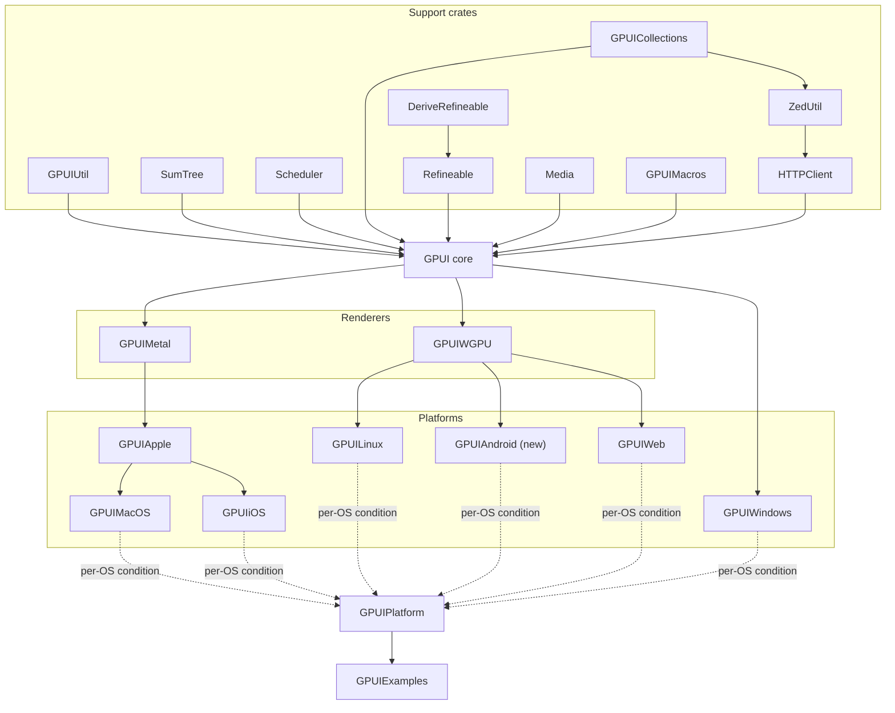

# Architecture

This doc covers how GPUI works, which is what we're porting, and how GPUA's targets fit together. Upstream references point at the pinned commit in [`porting.json`](../porting.json).

## 1. GPUI in one page

GPUI is a **hybrid immediate/retained-mode** UI framework.

- **Retained state lives in entities.** `App` owns every piece of app state in an `EntityMap`. Code holds `Entity<T>` handles and reads or updates state through a context: `entity.update(cx) { state, cx in … }`. Entities communicate with `cx.notify()` (re-render observers), `cx.emit(event)` + `cx.subscribe(…)`, and `cx.observe(…)`.
- **UI is rebuilt every frame (immediate mode).** A *view* is an entity whose type implements `Render`. Each frame, the window calls the root view's `render`, which returns a fresh tree of **elements** (`div()`, `text`, `img`, `svg`, `list`, `uniform_list`, `canvas`, …) styled with a Tailwind-like fluent API.
- **Elements go through three phases**: `request_layout` (build Taffy nodes) → `prepaint` (bounds known; register hitboxes, focus, scroll, and compute positions) → `paint` (push primitives into the scene). Element state that must survive between frames is keyed by `ElementId`/`GlobalElementId`.
- **The scene is a flat list of GPU primitives**: shadows, quads (rounded rects with borders and backgrounds), paths, underlines, monochrome/subpixel/polychrome sprites (glyphs, icons, images from a texture atlas), and surfaces. It is sorted by draw order and batched. The platform renderer draws those batches with a small set of shaders.
- **Input runs back through the frame**: platform events → hit-testing against the hitboxes registered in prepaint → mouse listeners; keystrokes → the **key dispatch tree** (focus path + keymap contexts) → **actions** → handlers.
- **Platforms are traits.** `Platform`, `PlatformWindow`, `PlatformDisplay`, `PlatformDispatcher`, `PlatformTextSystem`, and `PlatformAtlas` are implemented per OS. The core crate never touches the OS directly.

### The frame pipeline

```mermaid
flowchart LR
    VS["Platform vsync / request_frame"] --> D["Window::draw"]
    D --> R["Root view render() → element tree"]
    R --> L["request_layout (Taffy)"]
    L --> CL["compute_layout"]
    CL --> P1["prepaint (hitboxes, focus, scroll)"]
    P1 --> P2["paint (push primitives)"]
    P2 --> S["Scene (sort + batch)"]
    S --> GPU["Renderer: Metal / WebGPU / D3D11"]
    GPU --> PR["present"]
```

Upstream entry points: `Window::draw` and `Window::present` in [`window.rs`](https://github.com/Glass-HQ/gpui/blob/650aab59d54f4f6f85d42c965831935568ac1162/crates/gpui/src/window.rs), the `on_request_frame` callback set up in `Window::new`, and `Scene` in [`scene.rs`](https://github.com/Glass-HQ/gpui/blob/650aab59d54f4f6f85d42c965831935568ac1162/crates/gpui/src/scene.rs).

### The three "registers" (from upstream's README)

| Register | Use it for | Key types |
|---|---|---|
| Entities | Shared state and communication | `Entity<T>`, `WeakEntity<T>`, `Context<T>`, `EventEmitter`, `Subscription` |
| Views | Declarative UI | `Render`, `RenderOnce`, `IntoElement`, `div()`, `Styled`, `InteractiveElement` |
| Elements | Imperative, custom layout and paint | `Element`, `AnyElement`, `Window` paint APIs, `canvas` |

### Core subsystems → files

| Subsystem | Upstream files (in `crates/gpui/src/`) |
|---|---|
| App, contexts, entity map | `app.rs`, `app/*.rs`, `gpui.rs` (`AppContext`, `VisualContext`) |
| Window & frame | `window.rs`, `window/prompts.rs`, `view.rs` |
| Elements | `element.rs`, `elements/*.rs` (`div`, `text`, `img`, `svg`, `list`, `uniform_list`, `canvas`, `anchored`, `animation`, …) |
| Styling | `style.rs`, `styled.rs`, `color.rs`, `colors.rs`, `geometry.rs`, `taffy.rs` |
| Input | `interactive.rs`, `input.rs`, `key_dispatch.rs`, `keymap.rs`, `keymap/*.rs`, `action.rs`, `tab_stop.rs`, `platform/keystroke.rs` |
| Text | `text_system.rs`, `text_system/*.rs` (line layout cache, wrapping, font fallbacks/features) |
| Rendering data | `scene.rs`, `bounds_tree.rs`, `path_builder.rs`, `svg_renderer.rs`, `asset_cache.rs`, `elements/image_cache.rs` |
| Async | `executor.rs`, `platform_scheduler.rs`, plus the `scheduler` crate |
| Platform abstraction | `platform.rs`, `platform/*.rs` (+ `platform/test/*` test platform) |
| Glass-HQ additions | `composite_hosts/`, `hosted_views/`, `presentations/` (mixing native AppKit/UIKit views, menus, and popovers with GPUI surfaces) |

## 2. GPUA's target graph

Each upstream crate becomes one SwiftPM target with the same dependencies.

- **`GPUI`** is platform-independent Swift. It must build and pass its tests on every OS, using the `TestPlatform` from `platform/test/*`.
- **Renderers** turn a `Scene` into pixels. `GPUIMetal` serves Apple platforms. `GPUIWGPU` serves Linux, Android, and web, and can serve Windows as a fallback. Upstream Windows uses its own D3D11 renderer inside `gpui_windows`, and we port that as-is.
- **Platforms** implement the `Platform*` protocols for one OS family. All of their code sits inside `#if os(...)`, so every target compiles everywhere.
- **`GPUIPlatform`** exposes `application()`, `headless()`, and `current_platform()`, choosing the backend through SwiftPM's per-platform target conditions (upstream does the same with `cfg`-gated Cargo deps).

## 3. Platform layer contract

Each backend provides the following, matching `crates/gpui/src/platform.rs`:

| Protocol | Responsibility |
|---|---|
| `Platform` | Run loop, windows, displays, clipboard, cursor, menus, URL/file prompts, credentials, keyboard layout, appearance, thermal state |
| `PlatformWindow` | Native window/surface, bounds and scale, input callbacks, the `on_request_frame` vsync callback, `draw(scene)`, IME, decorations |
| `PlatformDisplay` | Monitor bounds, ids, uuids |
| `PlatformDispatcher` | Main-thread and background dispatch, timers. **This is the seam for deterministic tests.** |
| `PlatformTextSystem` | Font loading and matching, metrics, `layout_line` (shaping), glyph rasterization |
| `PlatformAtlas` | GPU texture atlas for glyphs, SVGs, and images (`etagere` allocator upstream) |

A new platform (Android) is "done" when it passes the same example gallery as the others. See [PLATFORMS.md](PLATFORMS.md).

## 4. Third-party Rust dependencies and their Swift counterparts

GPUI leans on a number of crates. Each one either has a Swift or platform equivalent, gets ported as another file-for-file upstream, or is wrapped from C. Any decision not yet backed by an ADR is marked *proposed*.

| Rust crate | Used for | Plan |
|---|---|---|
| `taffy` 0.9 | Flexbox/grid/block layout | **Port file-for-file** as a `Taffy` target (second upstream in `porting.json`). [ADR-0005](adr/0005-layout-engine.md) |
| `etagere` | Atlas rectangle packing | Port (small) into `GPUIUtil` or a `Etagere` target, *proposed* |
| `lyon` | Path building/tessellation (`path_builder.rs`) | Port the subset used, *proposed*. Alternative: vendored libtess2 |
| `resvg`/`usvg` | SVG rasterization | Vendored C `plutosvg`/`plutovg`, or a CoreGraphics-based renderer on Apple, *proposed* |
| `image` | PNG/JPEG/GIF/WebP decode | ImageIO on Apple; vendored `stb_image` elsewhere, *proposed* |
| `cosmic-text` + `swash` + `font-kit` | Text on Linux/web | FreeType + HarfBuzz + fontconfig (Linux), vendored FreeType/HarfBuzz (Android). [ADR-0006](adr/0006-text-stack.md) |
| `core-text`, `core-graphics`, `metal`, `cocoa`, `objc` | Apple platform | Native Swift frameworks |
| `windows` | Win32/D3D11/DirectWrite | Swift's `WinSDK` module |
| `wayland-client`, `x11rb`, `xkbcommon` | Linux windowing/input | `systemLibrary` C targets (`CWayland`, `CXCB`, `CXKBCommon`) |
| `wgpu` | Cross-platform GPU | `wgpu-native` (`webgpu.h`) via a C target or binary artifact. [ADR-0004](adr/0004-renderers.md) |
| `smol`/`async-task`/`futures`/`postage` | Async | Swift Concurrency + ported `Task`/channels. [ADR-0003](adr/0003-concurrency-model.md) |
| `parking_lot`, `smallvec`, `slotmap`, `collections` | Data structures | stdlib, `Synchronization.Mutex`, `GPUICollections` |
| `serde`, `schemars` | (De)serialization | `Codable`; schemas dropped |
| `uuid`, `url`, `regex`, `chrono` | Misc | Foundation / Swift `Regex` |
| `inventory`, `ctor` | Link-time registration | Explicit registration generated by macros |
