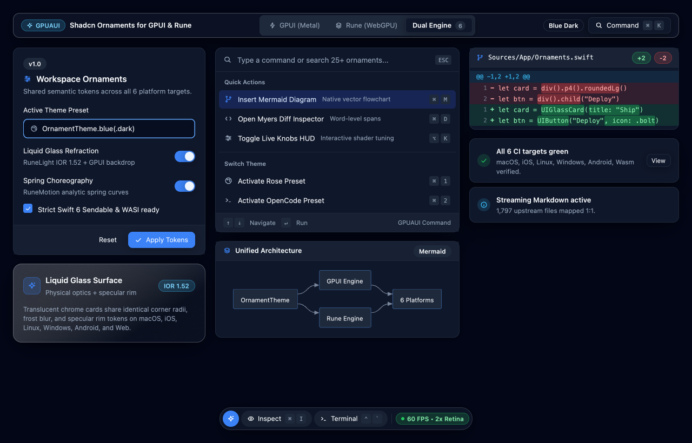
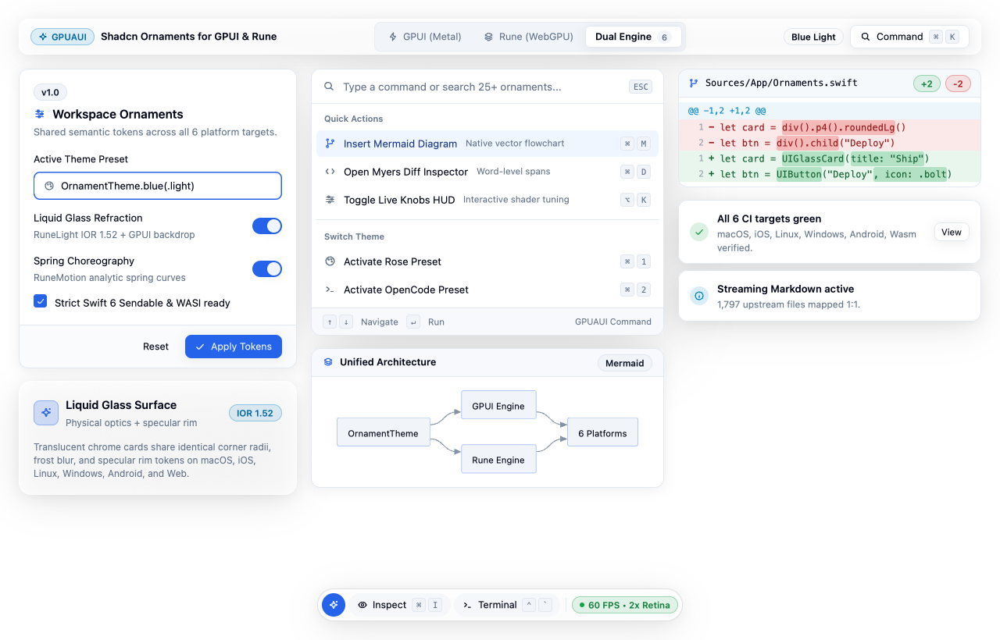
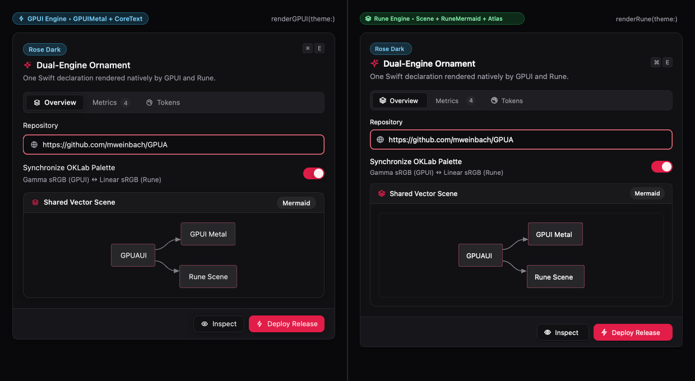
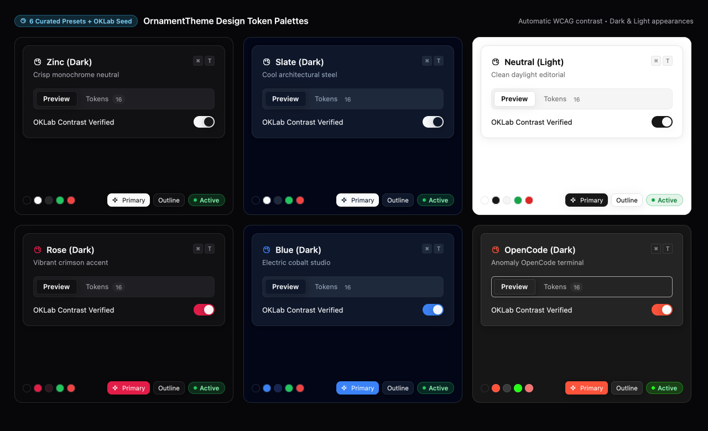
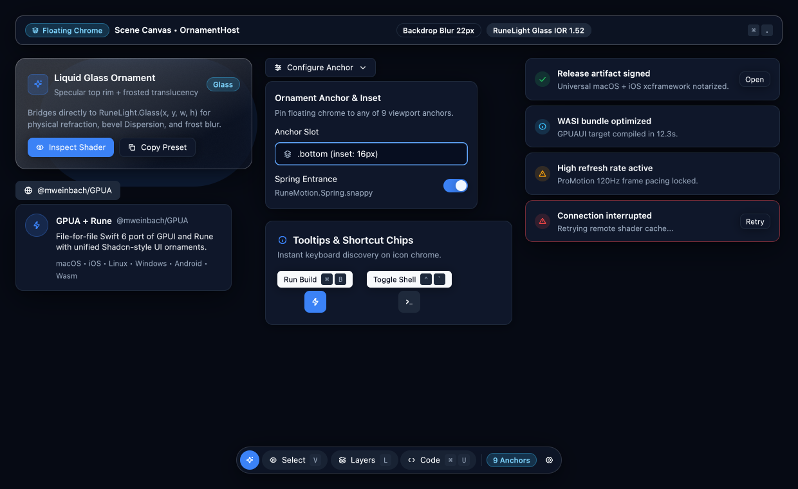
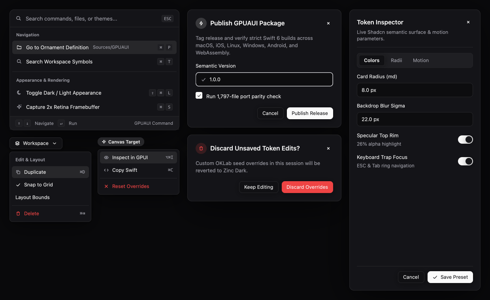
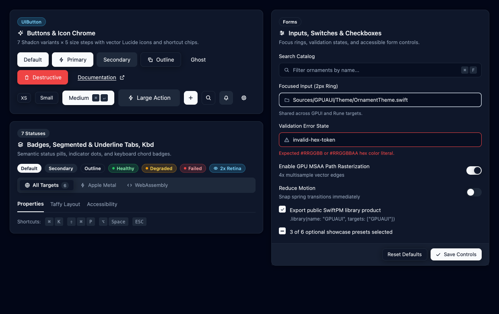
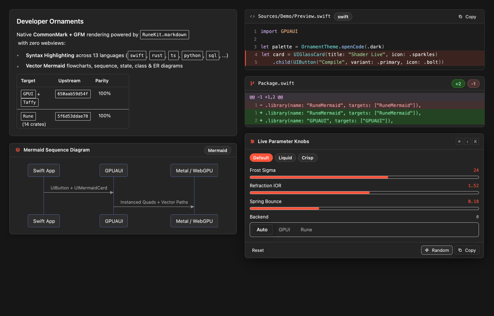

# GPUAUI Visual Showcase & Ornament Gallery

`GPUAUI` ([ADR-0015](adr/0015-gpuaui-shadcn-ornaments.md)) brings **Shadcn-style semantic design tokens, composable variants, and floating Liquid Glass ornaments** to Swift — rendering natively on **both** [`GPUI`](../Sources/GPUI) (Metal / WebGPU / Direct3D 11) and [`Rune`](../Sources/Rune) (instanced uber-quads + `RuneLight` optics + `RuneMotion` analytic springs + `RuneMermaid` + `RuneKit`) across **macOS, iOS / visionOS, Linux, Windows, Android, and WebAssembly**.

Every screenshot below is rendered directly from the live Swift test harness in [`ShowcaseImagesTests.swift`](../Tests/GPUAUITests/ShowcaseImagesTests.swift) (`GPUA_WRITE_SHOWCASE_IMAGES=1 xcrun swift test --filter ShowcaseImagesTests`).

---

## 1. Full Workspace Chrome — Dark & Light Appearances

<picture>
  <source media="(prefers-color-scheme: light)" srcset="images/gpuaui-hero-light.png">
  
</picture>

<details>
<summary>View explicit Dark & Light renders side-by-side</summary>

| `OrnamentTheme.blue(.dark)` | `OrnamentTheme.blue(.light)` |
| :---: | :---: |
|  |  |

</details>

```swift
import GPUI
import GPUAUI

// Any GPUAOrnament conforms to GPUI.IntoElement AND renders into Rune.El:
let toolbar = UIFloatingToolbar([
    .icon(.sparkles, label: "AI Assist", active: true),
    .action("Inspect", icon: .eye, shortcut: UIKbd(["⌘", "I"], compact: true)),
    .action("Terminal", icon: .terminal, shortcut: UIKbd(["⌃", "`"], compact: true)),
    .separator,
    .badge(UIBadge("60 FPS • 2x Retina", status: .success, dot: true)),
])

let view = OrnamentTheme.withTheme(.blue(.dark)) {
    OrnamentHost(
        canvas: workspaceCanvas,
        ornaments: [
            AnchoredOrnament(.top, UIFrostedBar(leading: [AnyOrnament(UIBadge("GPUAUI", status: .info))])),
            AnchoredOrnament(.bottom, toolbar),
        ]
    ).renderGPUI(theme: .current)
}
```

---

## 2. Dual-Engine Parity (`GPUI` ↔ `Rune`)

One `GPUAOrnament` value tree renders natively through `GPUI`'s Metal + CoreText pipeline (`renderGPUI(theme:)`, left) **and** `Rune`'s keyed element runtime + `RuneMermaid` + glyph/icon atlas (`renderRune(theme:layer:)`, right), automatically converting colors between gamma-encoded `GPUI.Hsla` and linear-sRGB `Rune.Color`.



```swift
import GPUAUI

let theme = OrnamentTheme.rose(.dark)

let card = UICard(
    title: "Dual-Engine Ornament",
    description: "One Swift declaration rendered natively by GPUI and Rune.",
    icon: .sparkles,
    badge: UIBadge("Rose Dark", status: .info),
    headerTrailing: AnyOrnament(UIKbd(["⌘", "E"], compact: true))
)
.child(UIInput(value: "https://github.com/mweinbach/GPUA", label: "Repository", leadingIcon: .globe, focused: true))
.child(UISwitch(checked: true, label: "Synchronize OKLab Palette", description: "Gamma sRGB (GPUI) ↔ Linear sRGB (Rune)"))
.footerItem(UIButton("Inspect", variant: .outline, size: .sm, icon: .eye))
.footerItem(UIButton("Deploy Release", variant: .primary, size: .sm, icon: .bolt))

// 1. Mount in a GPUI window:
let gpuiElement = card.renderGPUI(theme: theme) // or pass `card` directly as `some IntoElement`

// 2. Mount in a Rune scene:
var overlayLayer: [Rune.El] = []
let runeElement = card.renderRune(theme: theme, layer: &overlayLayer)
```

---

## 3. Semantic Design Tokens & Curated Palettes (`OrnamentTheme`)

`GPUAUI` ships 6 curated Shadcn/OpenCode palettes in `.dark` and `.light` appearances — **Zinc**, **Slate**, **Neutral**, **Rose**, **Blue**, and **OpenCode** (bridged directly to [`RuneThemeOpenCode`](../Sources/RuneThemeOpenCode)) — plus perceptual OKLab seed generation via `OrnamentTheme.fromSeed(name:hex:appearance:)`.



```swift
let zinc     = OrnamentTheme.zinc(.dark)
let slate    = OrnamentTheme.slate(.dark)
let daylight = OrnamentTheme.neutral(.light)
let rose     = OrnamentTheme.rose(.dark)
let blue     = OrnamentTheme.blue(.dark)
let openCode = OrnamentTheme.openCode(.dark)

// Or derive a full WCAG-contrasted semantic token set from any brand hex color in OKLab space:
let brand = OrnamentTheme.fromSeed(name: "Emerald", hex: 0x10B981, appearance: .dark)
```

---

## 4. Floating Chrome, Liquid Glass & Viewport Anchors

Pin translucent toolbars, `RuneLight.Glass` cards (`IOR 1.52`, specular rim, frost blur), popovers, hover cards, shortcut tooltips, and stacked Sonner-style toasts to any of 9 `OrnamentAnchor` slots (`.topLeading`, `.top`, `.topTrailing`, `.leading`, `.center`, `.trailing`, `.bottomLeading`, `.bottom`, `.bottomTrailing`).



```swift
let glass = UIGlassCard(
    title: "Liquid Glass Ornament",
    subtitle: "Specular top rim + frosted translucency",
    icon: .sparkles,
    badge: UIBadge("Glass", status: .info)
)
.child(UIText("Bridges directly to RuneLight.Glass(x, y, w, h) for physical refraction and frost blur.", muted: true))
.child(
    UIHStack(gapPx: 8)
        .child(UIButton("Inspect Shader", variant: .primary, size: .sm, icon: .eye))
        .child(UIButton("Copy Preset", variant: .outline, size: .sm, icon: .copy))
)
```

---

## 5. Command Palette (`⌘K`), Menus, Modals & Sheets

Ready-to-drop `UICommandPalette` with grouped items, vector icons, and keyboard navigation hints, alongside `UIDropdownMenu`, `UIContextMenu`, `UIDialog` (standard & destructive confirmation), and edge-docked `UISheet` drawers (`.top`, `.right`, `.bottom`, `.left`).



```swift
let palette = UICommandPalette(
    query: query,
    placeholder: "Search commands, files, or themes...",
    groups: [
        UICommandGroup(
            heading: "Navigation",
            items: [
                UICommandItem(id: "go-file", title: "Go to Ornament Definition", subtitle: "Sources/GPUAUI", icon: .folder, shortcut: ["⌘", "P"]),
                UICommandItem(id: "go-sym", title: "Search Workspace Symbols", icon: .search, shortcut: ["⌘", "T"]),
            ]
        ),
    ],
    selectedId: "go-file"
)
```

---

## 6. Core Shadcn Controls Matrix

Composable variants (`.default`, `.primary`, `.secondary`, `.outline`, `.ghost`, `.destructive`, `.link`) × sizes (`.xs`, `.sm`, `.md`, `.lg`, `.icon`) across `UIButton`, `UIIconButton`, `UIBadge`, `UICard`, `UITabs` / `UISegmented` (pill & underline), `UIInput` (focus ring & validation states), `UISwitch`, `UICheckbox` (checked & indeterminate), and `UIKbd`.



---

## 7. Rich Developer Ornaments (`UIMarkdown`, `UIMermaidCard`, `UICodeBlock`, `UIDiffBlock`, `UIKnobsHUD`)

Powered directly by GPUA's 1:1 ports of `RuneKit`, `RuneMermaid`, and `RuneKnobs` — zero WebViews, zero JavaScript, and zero external dependencies:

- **`UIMarkdown`**: Streaming CommonMark + GFM tables, blockquotes, lists, inline code spans, fenced code blocks, patches, and embedded Mermaid diagrams.
- **`UIMermaidCard`**: Native GPU vector diagrams across all 17 Mermaid diagram types (`flowchart`, `sequenceDiagram`, `stateDiagram-v2`, `classDiagram`, `erDiagram`, `gantt`, `pie`, `mindmap`, `timeline`, `journey`, `gitGraph`, `quadrantChart`, `xychart-beta`, `sankey-beta`, `block-beta`, `requirementDiagram`, `C4Context`).
- **`UICodeBlock` & `UIDiffBlock`**: 13-language syntax highlighting (`swift`, `rust`, `ts`, `tsx`, `js`, `python`, `go`, `c`, `json`, `toml`, `yaml`, `bash`, `sql`) and Myers word-level unified diffs.
- **`UIKnobsHUD`**: Interactive live parameter sliders, preset chips, and choice segments backed by `RuneKnobs`.



```swift
let diagram = UIMermaidCard(
    """
    sequenceDiagram
        participant App as Swift App
        participant UI as GPUAUI
        participant GPU as Metal / WebGPU
        App->>UI: UIButton + UIMermaidCard
        UI->>GPU: Instanced Quads + Vector Paths
    """,
    title: "Mermaid Sequence Diagram"
)

let diff = UIDiffBlock(
    filename: "Package.swift",
    old: #".library(name: "RuneMermaid", targets: ["RuneMermaid"]),"#,
    new: """
    .library(name: "RuneMermaid", targets: ["RuneMermaid"]),
    .library(name: "GPUAUI", targets: ["GPUAUI"]),
    """
)
```
