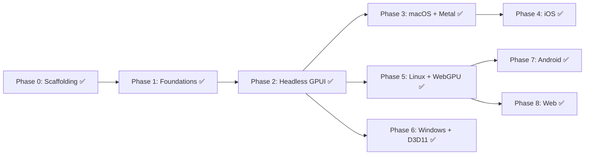

# Roadmap

The port runs **bottom-up along the dependency graph**: support crates, then GPUI value types, then the headless app model, then platforms. Once Phase 2 lands, Phases 3–8 are independent of each other and can run in parallel.

## Phase 0: Scaffolding ✅

- [x] Repo, license/notice, README, AGENTS.md, docs, ADRs
- [x] `porting.json` + `Scripts/port.py` (map / scaffold / status / check / stale / bump)
- [x] Stubs for every upstream file. `swift build` passes on macOS
- [x] CI: port-check + macOS/Linux/Windows build, Android cross-compile

## Phase 1: Foundations (pure Swift, no platform code) ✅

Goal: the leaf crates and GPUI's value types are ported, with tests green on all three desktop OSes.

1. **Support crates**, smallest first:
   - [x] `GPUICollections` (`collections`): type aliases → stdlib, plus `VecMap`
   - [x] `GPUIUtil` (`gpui_util`)
   - [x] `Refineable` + `DeriveRefineable` ([ADR-0007](adr/0007-macro-free-protocols.md))
   - [x] `SumTree` (`sum_tree`): ported with property & stress tests
   - [x] `Scheduler` (`scheduler`): deterministic test scheduler
   - [x] `ZedUtil`: ported files used by GPUI and platforms; remainder marked `skipped`
2. **Taffy**: [x] `taffy` 0.9.0 ported file-for-file ([ADR-0005](adr/0005-layout-engine.md)).
3. **GPUI value types**:
   - [x] `geometry.rs` (Point/Size/Bounds/Edges/Corners/Pixels/ScaledPixels/DevicePixels/Rems/AbsoluteLength/DefiniteLength/Length)
   - [x] `color.rs`, `colors.rs`
   - [x] `shared_string.rs`, `shared_uri.rs`, `util.rs`, `arena.rs`
   - [x] `style.rs`, `styled.rs` (+ `GPUIMacros/styles.swift`), `taffy.rs`
   - [x] `scene.rs`, `bounds_tree.rs`, `path_builder.rs`
   - [x] `platform/keystroke.rs`, `keymap.rs`, `keymap/*.rs`, `action.rs`
4. [x] **Macro-free protocol defaults ADR ([ADR-0007](adr/0007-macro-free-protocols.md))**: zero-dependency Swift protocol extensions replacing proc-macro codegen.

## Phase 2: Headless GPUI ✅

Goal: the whole framework runs on `TestPlatform`, with upstream `#[gpui::test]` suites passing.

- [x] `executor.rs`, `platform_scheduler.rs`, `Task<T>` + Swift async bridging ([ADR-0003](adr/0003-concurrency-model.md))
- [x] `app.rs`, `app/entity_map.rs`, `app/app_context.rs` (from `context.rs`), `app/async_context.rs`, `subscription.rs`, `global.rs`
- [x] `platform.rs` (protocols) + `platform/test/*` (TestPlatform, TestWindow, TestDispatcher, TestDisplay)
- [x] `window.rs`, `view.rs`, `element.rs`, `elements/*.rs`
- [x] `text_system.rs` + `text_system/*` against `TestPlatform`
- [x] `key_dispatch.rs`, `interactive.rs`, `input.rs`, `tab_stop.rs`
- [x] `app/test_context.rs`, `app/test_app.rs`, `test.rs` + `GPUIMacros` test harness
- [x] Scene snapshot & headless E2E tests across all ported examples

## Phase 3: First pixels on macOS ✅

- [x] `GPUIMetal` (`renderer.rs`, `atlas.rs`, `shaders.metal` + GPU layout parity compute tests)
- [x] `GPUIApple` (shared AppKit/UIKit host views, composite hosts, presentations; [ADR-0011](adr/0011-apple-native-and-ios-host.md))
- [x] `GPUIMacOS` (`platform.rs`, `window.rs`, `events.rs`, `display_link.rs`, `text_system.rs`, `keyboard.rs`, `dispatcher.rs`, `pasteboard.rs`, `screen_capture.rs`, …)
- [x] `GPUIPlatform` unified across all 6 OS families
- [x] `GPUIExamples`: all 32 upstream examples ported
- [x] Offscreen Metal GPU render & PNG smoke harness (`hello_world_macos.png`)

## Phase 4: iOS / visionOS ✅

- [x] `GPUIiOS` (+ `text_input/*`, gestures, drag & drop, lifecycle, display link, CoreText `IosTextSystem`)
- [x] `Hosts/iOS` (XcodeGen `project.yml` + Swift `AppMain.swift` runner)
- [x] `gpui_examples/src/ios.rs` demos + iOS Simulator test suite (`GPUIiOSTests`)

## Phase 5: Linux ✅

- [x] `wgpu-native` integration (`CWebGPU`) and `GPUIWGPU` renderer + atlas ([ADR-0008](adr/0008-linux-system-interop.md))
- [x] FreeType/HarfBuzz/Fontconfig text system (`cosmic_text_system.swift`, [ADR-0006](adr/0006-text-stack.md))
- [x] `GPUILinux`: Wayland, X11, headless, `xdg-desktop-portal` + Vulkan/Lavapipe screenshot verification (`hello_world_linux.png`)

## Phase 6: Windows ✅

- [x] `GPUIWindows` + `CWinSys` file-for-file: `platform.rs`, `window.rs`, `events.rs`, `directx_renderer.rs`, `directx_atlas.rs`, `direct_write.rs`, HLSL shaders, + D3D11/WARP screenshot verification (`hello_world_windows.png`, [ADR-0009](adr/0009-windows-com-and-shaders.md))

## Phase 7: Android ✅

- [x] [ADR-0012](adr/0012-android-platform-and-jni.md) for `CAndroidSys` NDK/JNI bridge, Android Keystore credentials, and host app
- [x] `GPUIAndroid` on `GPUIWGPU` (Vulkan) + NDK `AFontMatcher` & TrueType/OpenType rasterizer
- [x] `Hosts/android` Gradle + Kotlin shell (`GPUIActivity.kt`, `GPUISurfaceView.kt`)

## Phase 8: Web ✅

- [x] [ADR-0013](adr/0013-web-wasm-bridge.md) zero-dependency `CWebSys` + `CWebGPU` WASI C-ABI bridge
- [x] `GPUIWeb` + `GPUIWGPU` targeting browser `navigator.gpu` WebGPU (`gpui-examples.wasm`)
- [x] `Hosts/web` (`index.html`, `gpui_web_runtime.js`)

## Ongoing

- **Upstream sync**: bump the pin on a regular cadence, monthly or so ([UPSTREAM_SYNC.md](UPSTREAM_SYNC.md)).
- **Tooling**: port `cargo-gpui` as a SwiftPM command plugin (`swift package gpui run ios`).
- **Performance**: frame-time benchmarks against Rust GPUI (`tooling/perf`).
