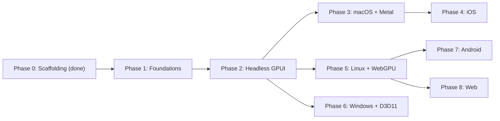

# Roadmap

The port runs **bottom-up along the dependency graph**: support crates, then GPUI value types, then the headless app model, then platforms. Once Phase 2 lands, Phases 3–8 are independent of each other and can run in parallel.

## Phase 0: Scaffolding ✅

- [x] Repo, license/notice, README, AGENTS.md, docs, ADRs
- [x] `porting.json` + `Scripts/port.py` (map / scaffold / status / check / stale / bump)
- [x] Stubs for every upstream file. `swift build` passes on macOS
- [x] CI: port-check + macOS/Linux/Windows build, Android cross-compile

## Phase 1: Foundations (pure Swift, no platform code)

Goal: the leaf crates and GPUI's value types are ported, with tests green on all three desktop OSes.

1. **Support crates**, smallest first:
   - [ ] `GPUICollections` (`collections`): type aliases → stdlib, plus a Swift-only `SlotMap`
   - [ ] `GPUIUtil` (`gpui_util`)
   - [ ] `Refineable` + `DeriveRefineable` (needs the swift-syntax ADR → `@Refineable` macro)
   - [ ] `SumTree` (`sum_tree`): used by `list.rs`. Port its tests carefully
   - [ ] `Scheduler` (`scheduler`): the deterministic test scheduler. **Critical for Phase 2**
   - [ ] `ZedUtil`: only the files GPUI and the platforms actually use. Mark the rest `skipped`
2. **Taffy**: add `taffy` 0.9.0 as a second upstream in `porting.json` and port it file-for-file ([ADR-0005](adr/0005-layout-engine.md)).
3. **GPUI value types**, in roughly this order:
   - [ ] `geometry.rs` (Point/Size/Bounds/Edges/Corners/Pixels/ScaledPixels/DevicePixels/Rems/AbsoluteLength/DefiniteLength/Length)
   - [ ] `color.rs`, `colors.rs`
   - [ ] `shared_string.rs`, `shared_uri.rs`, `util.rs`, `arena.rs`
   - [ ] `style.rs`, `styled.rs` (+ `GPUIMacros/styles.swift`), `taffy.rs`
   - [ ] `scene.rs`, `bounds_tree.rs`, `path_builder.rs` (decide on lyon, see ARCHITECTURE §4)
   - [ ] `platform/keystroke.rs`, `keymap.rs`, `keymap/*.rs`, `action.rs` (+ `@Action` macro)
4. [ ] **Macro infrastructure ADR + swift-syntax dependency.** `GPUIMacros` and `DeriveRefineable` become `.macro` targets.

## Phase 2: Headless GPUI

Goal: the whole framework runs on `TestPlatform`, with upstream `#[gpui::test]` suites passing.

- [ ] `executor.rs`, `platform_scheduler.rs`, `Task<T>` + Swift async bridging ([ADR-0003](adr/0003-concurrency-model.md))
- [ ] `app.rs`, `app/entity_map.rs`, `app/app_context.rs` (from `context.rs`), `app/async_context.rs`, `subscription.rs`, `global.rs`
- [ ] `platform.rs` (protocols) + `platform/test/*` (TestPlatform, TestWindow, TestDispatcher, TestDisplay)
- [ ] `window.rs`, `view.rs`, `element.rs`, `elements/*.rs` (start with `div.rs`, `text.rs`, `canvas.rs`)
- [ ] `text_system.rs` + `text_system/*` against a fake/test `PlatformTextSystem`
- [ ] `key_dispatch.rs`, `interactive.rs`, `input.rs`, `tab_stop.rs`
- [ ] `app/test_context.rs`, `app/test_app.rs`, `test.rs` + the `.gpui` Swift Testing trait (`gpui_macros/src/test.rs`)
- [ ] Scene snapshot tests: render `hello_world`'s view headlessly and compare the primitive list against the Rust version

## Phase 3: First pixels on macOS

- [ ] `GPUIMetal` (`renderer.rs`, `atlas.rs`, `shaders.metal`)
- [ ] `GPUIApple` (shared AppKit/UIKit bits; most `objc/*` `skipped`)
- [ ] `GPUIMacOS` (`platform.rs`, `window.rs`, `events.rs`, `display_link.rs`, `text_system.rs`, `keyboard.rs`, `dispatcher.rs`, …)
- [ ] `GPUIPlatform`
- [ ] `GPUIExamples`: `hello_world`, `shadow`, `gradient`, `text`, `scrollable`, `uniform_list`, `input`
- [ ] Pixel comparison harness against Rust GPUI screenshots (`visual_test.rs`)

## Phase 4: iOS / visionOS

- [ ] `GPUIiOS` (+ `text_input/*`, gestures, lifecycle, display link)
- [ ] `Hosts/iOS` (xcodegen project + Swift runner)
- [ ] Port `gpui_examples/src/ios.rs` demos

## Phase 5: Linux

- [ ] wgpu-native integration (C target / binary artifact) and the `GPUIWGPU` renderer + atlas
- [ ] FreeType/HarfBuzz/fontconfig text system (replacing `cosmic_text_system.rs` behavior; see [ADR-0006](adr/0006-text-stack.md))
- [ ] `GPUILinux`: Wayland first, then X11, headless, xdg-desktop-portal

## Phase 6: Windows

- [ ] `GPUIWindows` file-for-file: `platform.rs`, `window.rs`, `events.rs`, `directx_renderer.rs`, `directx_atlas.rs`, `direct_write.rs`, …

## Phase 7: Android

- [ ] Design doc + ADR for the `GPUIAndroid` structure, JNI approach, and host app
- [ ] `GPUIAndroid` on `GPUIWGPU` (Vulkan) + FreeType/HarfBuzz
- [ ] `Hosts/android` Gradle shell

## Phase 8: Web

- [ ] `GPUIWeb` via the Swift SDK for Wasm + JavaScriptKit + browser WebGPU
- [ ] `Hosts/web`

## Ongoing

- **Upstream sync**: bump the pin on a regular cadence, monthly or so ([UPSTREAM_SYNC.md](UPSTREAM_SYNC.md)).
- **Tooling**: port `cargo-gpui` as a SwiftPM command plugin (`swift package gpui run ios`).
- **Performance**: frame-time benchmarks against Rust GPUI (`tooling/perf`).
